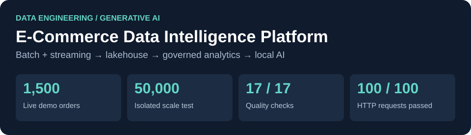
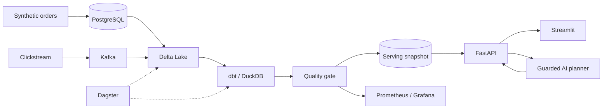
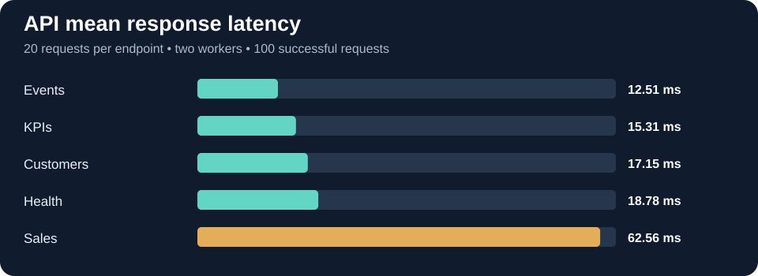
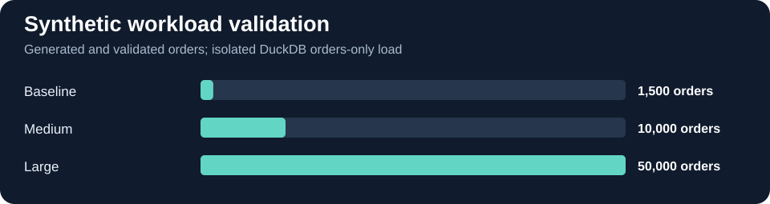
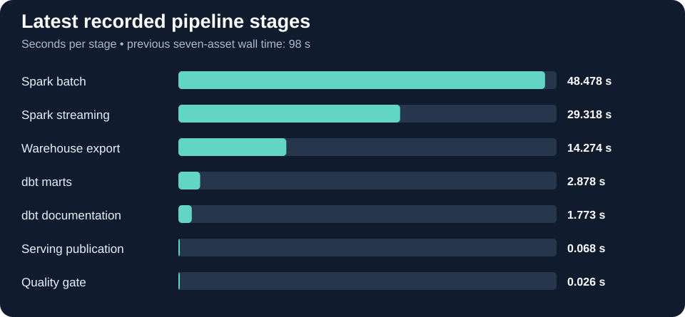

# E-Commerce Data Intelligence Platform

[](https://github.com/ram4798/ecommerce-data-intelligence-platform/actions/workflows/ci.yml)  

Local-first, reproducible data engineering and AI analytics portfolio using synthetic commerce data. Built with Python, PostgreSQL, Kafka, PySpark, Delta Lake, dbt, DuckDB, Dagster, Prometheus, Grafana, FastAPI, Streamlit and Ollama.



**Explore:** [Architecture](#architecture) · [What it demonstrates](#what-it-demonstrates) · [Performance](#performance-at-a-glance) · [Setup](#setup-and-demo) · [Documentation](#documentation)

## Architecture



[Detailed architecture and limitations](docs/architecture.md).

## What it demonstrates

- Transactional and replay-safe relational ingestion; Kafka manual offset commit and dead-letter handling.
- Independent Spark batch and available-now streaming, Delta Bronze/Silver/Gold, watermark deduplication.
- dbt dimensions, facts, marts and tests; seven-asset Dagster orchestration.
- Quality gates, metrics, alert rules and last-good atomic serving snapshot.
- Read-only REST API and interactive sales, customer, events, quality and AI dashboard.
- Local LLM structured plans and deterministic intent rules, allowlisted parameterized SQL, evidence.
- Service lifecycle commands, reproducible benchmarks and isolated failure-recovery tests.

## Performance at a glance







Measured locally on Apple M2, 8 GB RAM, November 24, 2026. The scaling benchmark generated and validated relational records but loaded only orders into temporary DuckDB; it is not full-stack throughput. Stage durations are historical observations. See [benchmark methodology and results](docs/performance.md).

## Application walkthrough

| Screen | What to demonstrate |
|---|---|
| Sales | Gross and paid values, orders, customers, units and filters |
| Streaming | 100 unique events, 64 sessions, event breakdown |
| Quality | 17 published checks and latest pipeline status |
| AI assistant | Ranked customers, dollar-formatted table, SQL and parameters |
| Dagster / Grafana | Asset dependencies, execution history and monitoring |

[Five-minute live demo guide](docs/demo.md). Actual application screenshots will be added after clean captures are available; charts above are generated from observed benchmark values, not mock application screenshots.

## Setup and demo

Prerequisites: Python 3.11, Java 17, Docker Desktop with Compose, Ollama for AI. Tested locally on Apple M2 with 8 GB RAM; no paid cloud required. Optional OpenAI incurs API fees.

```bash
python3.11 -m venv .venv
source .venv/bin/activate
pip install -r requirements-stream.txt -r requirements-lakehouse.txt -r requirements-orchestration.txt -r requirements-app.txt
cp .env.example .env  # first setup only; configure local password
python -m ecommerce.service_manager start infra
python -m ecommerce.batch --start 1 --count 1000
python -m ecommerce.batch --start 1001 --count 500
```

Follow [streaming setup](docs/streaming.md) to create topics and populate events, then [lakehouse](docs/lakehouse.md) and [orchestration](docs/orchestration.md) to refresh the seven assets and publish a snapshot. Start Ollama temporarily to download `qwen2.5:3b` (see assistant guide), then stop the manual server before using the manager.

```bash
python -m ecommerce.service_manager start app
python -m ecommerce.service_manager status all
```

Dashboard: http://127.0.0.1:8501 · API: http://127.0.0.1:8000/docs · Dagster: http://127.0.0.1:3000 (start separately) · Grafana: http://127.0.0.1:3001 · Prometheus: http://127.0.0.1:9090.

Try "How many total orders do we have?" or "Who are the top 5 customers by paid value?" Inspect query evidence. To stop managed app services without deleting data: `python -m ecommerce.service_manager stop app`.

## Verified local baseline

1500 orders, 3026 order lines, 100 customers, 100 events, 17 quality checks passed, seven-asset refresh 98 s (Nov 24, 2026). Phase 8 local automated tests 6/6. These are observed demo results, not production-scale claims. Phase 9 benchmarks are now recorded: 100/100 HTTP requests succeeded; KPI mean latency 15.31 ms; local LLM order-count mean 6.84 s; deterministic customer-count mean 45.68 ms (three trials each, different questions). Isolated scale test generated and validated 50,000 orders and 100,227 order lines, loaded orders into temporary DuckDB and reconciled totals. Phase 9 tests 6/6; managed application shutdown/start verified. See [measured results](docs/performance.md) for scope and caveats.

## Portfolio and demonstration

- [Project case study](docs/case-study.md): problem, implementation, evidence and trade-offs.
- [Demo walkthrough](docs/demo.md): reproducible presentation and screenshot checklist.
- [Interview guide](docs/interview-guide.md): architecture, debugging and design questions.
- [Production-readiness roadmap](docs/roadmap.md): proposed improvements, not deployed capabilities.

Repository map: `ecommerce/` pipelines, API, AI and operations; `analytics/` dbt project; `dashboard/` Streamlit; `sql/` relational schema; `monitoring/` Prometheus/Grafana configuration; `tests/` unit and integration tests; `docs/` setup and design; `.github/workflows/` CI. Local data and logs are excluded.

## Documentation

| Topic | Guide |
|---|---|
| Architecture / data contracts | [Architecture](docs/architecture.md) |
| Batch generation / ingestion | [Batch](docs/batch.md) |
| Kafka and replay | [Streaming](docs/streaming.md) |
| Spark / Delta | [Lakehouse](docs/lakehouse.md) |
| dbt / Dagster | [Orchestration](docs/orchestration.md) |
| Quality / alerts | [Monitoring](docs/monitoring.md) |
| REST / dashboard | [Application](docs/application.md) |
| AI / evaluation | [Assistant](docs/assistant.md) |
| Operations / benchmarking / recovery | [Performance](docs/performance.md) |

## Tests and constraints

`python -m unittest discover -s tests -v` runs dependency-light tests; opt-in integration suites run in GitHub Actions. **Never set RUN_DB_TESTS=1 against retained data:** that suite drops its test schema. Use disposable infrastructure. Local .env, generated data, logs and model weights are not committed. No authentication, distributed HA or production SLA; no real customer data. Inventory is a static snapshot, returns are not subtracted from paid value, clickstream is independent of batch orders. Model intent is not guaranteed correct; evidence is inspectable. See architecture for boundaries.
