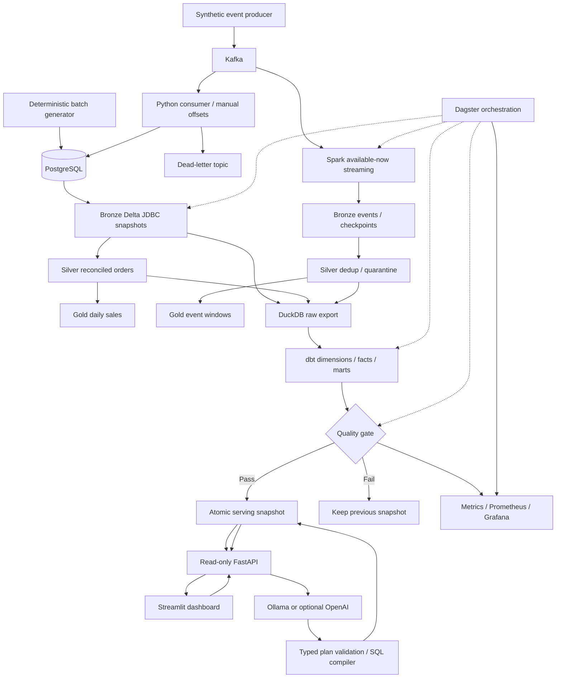

# System architecture

Independent local-first synthetic e-commerce project. Target hardware measured locally: Apple M2, 8 GB unified RAM. No employer or customer data.

## Contracts and boundaries

Batch IDs deterministic; transactional insert-on-conflict-ignore. Kafka is single-broker KRaft; raw consumer commits after PostgreSQL write, with DLQ. Spark independently reads Kafka with checkpoints, watermark and insert-only MERGE. Late events can be dropped by watermark; no global exactly-once guarantee. Gold windows rebuilt from retained Silver. DuckDB export and dbt incremental facts are append-oriented; no CDC update/delete semantics. Quality gates publication, not all intermediate tables. Serving file replacement is atomic on local filesystem; API connections are read-only. API money is integer cents; dashboard displays dollars. Synthetic clickstream is not linked to orders.

AI uses a bounded typed query plan or explicit business rules, never model SQL. Answers are computed from serving data. LLM can still misunderstand intent. OpenAI opt-in transmits questions and schema/filter metadata, not result rows. All services bind to loopback where exposed; no public auth, TLS, HA or cloud deployment.

## Operational flow

Run the seven-asset refresh sequentially: batch_delta → streaming_delta → warehouse_sources → dbt_marts → quality_gate → dbt_documentation and publish_serving. Hourly schedule is defined but disabled by default. Monitoring stores local metrics and alerts, not external notifications. Avoid concurrent Spark and LLM workloads on 8 GB RAM.
